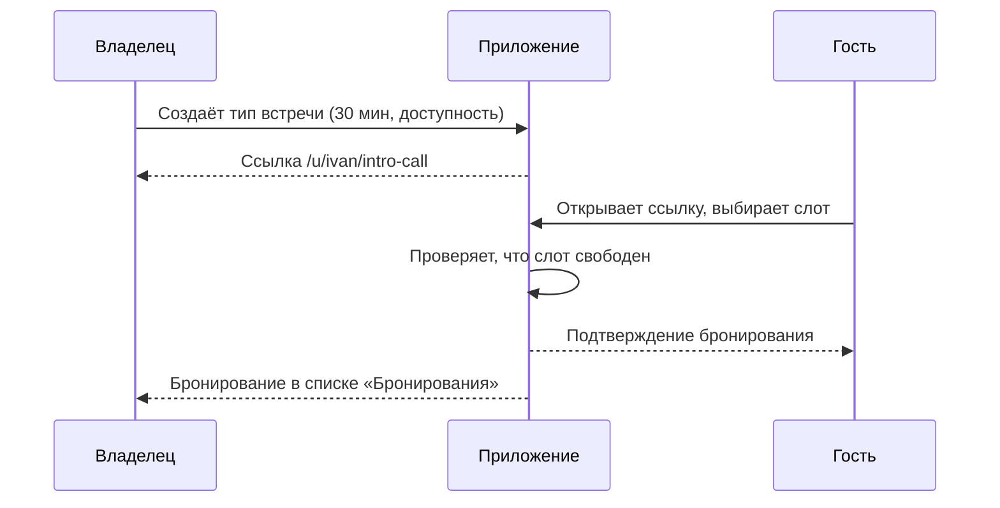

# Календарь звонков


[](https://github.com/MNSolov/ai-for-developers-project-386/actions)

Разработайте совместно с ИИ сервис для бронирования календаря

Учебный проект Хекслета: https://ru.hexlet.io/programs/ai-for-developers
Как это должно работать: https://files.hexlet.app/a/2ipc5m

## Сценарий использования

Короткий путь от создания встречи до записи в списке владельца:

1. **Создание типа встречи.** Владелец входит в приложение и создаёт тип встречи — например, «Вводный звонок»: указывает название, длительность (30 минут) и интервалы доступности.
2. **Публичная ссылка.** Приложение генерирует ссылку для бронирования, например `/u/ivan/intro-call`. Владелец отправляет её гостю любым удобным способом.
3. **Бронирование гостем.** Гость открывает ссылку, выбирает свободный слот в календаре и оставляет имя, email и комментарий. Приложение проверяет, что слот ещё свободен, и создаёт бронирование.
4. **Запись у владельца.** Бронирование сразу появляется в разделе «Бронирования» личного кабинета владельца: гость, дата и время, длительность и статус.



## Стек

- Разное

## Установка

<!-- Опишите установку: клонирование, зависимости, переменные окружения -->

```bash
git clone https://github.com/MNSolov/ai-for-developers-project-386.git
cd ai-for-developers-project-386
```

## Использование

<!-- Добавьте примеры запуска и запись asciinema — именно это смотрит работодатель -->

---

<details>
<summary>Автоматические тесты Хекслета</summary>

Тесты запускаются на каждый коммит. За запуск отвечает файл `.github/workflows/hexlet-check.yml` — не удаляйте и не переименовывайте ни его, ни репозиторий.

</details>

## О Хекслете

[Хекслет](https://ru.hexlet.io/) — школа программирования: авторские программы обучения с практикой, поддержкой наставников и реальными проектами, которые остаются в резюме. Этот репозиторий — один из таких проектов.
